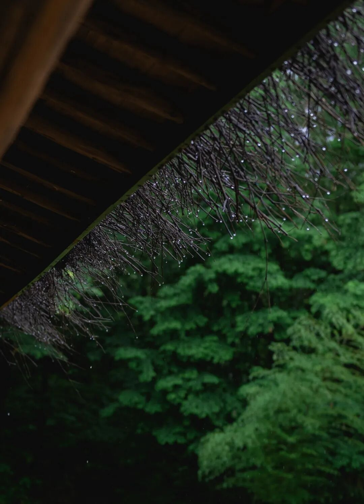

# 渐渐

- 公众号：西多梅
- 发布时间：2025-11-07T00:49:52
- 原文：http://mp.weixin.qq.com/s?__biz=MzYyMTkyNjU1Mg==&mid=2247483662&idx=1&sn=0cc71b986200514d019b757ae49a6a9d&chksm=feccf6e6a6bd56c6a2a534d9133923cd684401831b1d37fcabb45eea541594c60476f856c610&scene=126&sessionid=0#rd

> “宁愿天天下雨，以为你是下雨不来”

## 正文

熬过了小城的又一个雨季，你或许发现不过如此。

下过雨的晨风是清甜的梅子酒，醉着踏上第一块石板路，在一瞬间掉进静止的空气里。好像要从里向外翻新自己。

好像这一刻最重要的是踩过干净的青苔，任凭清凉的东西扑了满身。早晨的无根水适合洗礼奔波的人。

总是在下雨，渐渐也就习惯了撑起伞时前一天的潮湿，不再对伞下没有面孔的身影感到好奇，也可以素面朝天将人造纤维作为保护色。

"宁愿天天下雨，以为你是下雨不来。"

有没有可能，雨天走散的人们再也回不来，那张磁带也总在一个音节里徘徊。独留我一个，也在雨里徘徊。

情非所愿而已。既多情自古伤离别，杨柳岸晓风残月酒醒之处，兰舟已过万重山，而你还在绛云轩里让着新沏的茶。何尝不是慢冷的人自我折磨又归得一片白茫茫大地，真干净。

早晚都要告别的人，就不必留了吧。

你会习惯没有他的世界，渐渐陌生了此去经年，渐渐地雨会帮你冲洗良辰好景直到如宣纸寡淡。你会发现某天你醒来，回忆里有一瞬的空白，甚至微小到作为水滴的高光而存在。

这就是你珍视珍惜珍爱的感情，连告别都没留下。

