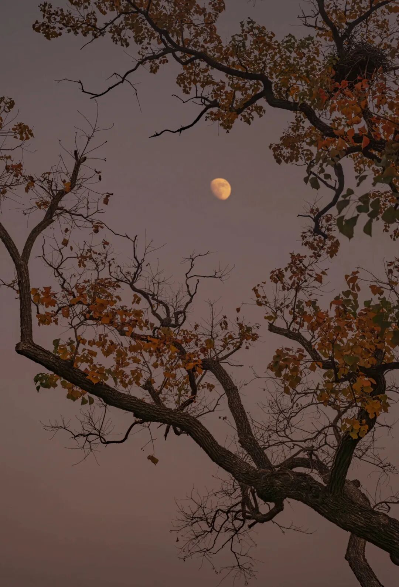

# 惟一

- 公众号：西多梅
- 发布时间：2025-11-12T23:17:26
- 原文：http://mp.weixin.qq.com/s?__biz=MzYyMTkyNjU1Mg==&mid=2247483695&idx=1&sn=873a6aa1764d86083a970f82e7bd5d35&chksm=fe62447b41bc95a015253035b7e42b9f33154dcde715ab6830814688c769b7112996ed451cb9&scene=126&sessionid=0#rd

> 乐天拥有的那弯浔阳江 并不适合存放秋月

## 正文

"唯见江心秋月白"。这次我写对了。

我也天真地想象过"惟一"与"唯一"的区别。心里的莞莞才是惟一，再明媚的解语花也只有唇齿一开合挤出的唯一，三分像她也是你的福气。

原来乐天拥有的那弯浔阳江，并不适合存放秋月。

之所以想，一定有缘由所在。

是你看透了一些事情，明白它的因果未来，却如何也碌磨不透的自己，还是真正的那轮秋月，明净的你的惟一？

你究竟从哪天开始下决心，不写他，不写爱情。

他真的救赎了你吗，还是一直以来你蓄起的长发只是三千烦恼而已。

当打开张爱玲的小说，你会觉得他因为下雨不来，觉得墓碑一样沉重的，居然是他的月色，于是你翻出未抄完的《上林赋》，寥寥几笔却滞涩地停顿成斑驳的墨迹，你弹琴的时候觉得弹挑清脆的珠玉是他，轮指悠远的绵长是他，回弦一声如裂帛撕开的也是他。你翻开写过的东西淡黄纸页上莫名潮湿腥咸，他的字迹明晃晃贴在首页——算了吧。你想说你还未开口，便被扼杀。

你不会忘记每次酗咖啡喝酒吹风喊叫看夕阳脑子里会抽痛吧。你写道你会一直定格他的帧帧图画，看两份星座运势，摆牌阵的时候看不懂他，什么样的词语才能形容他。

惟一一个，不只是唯一。

