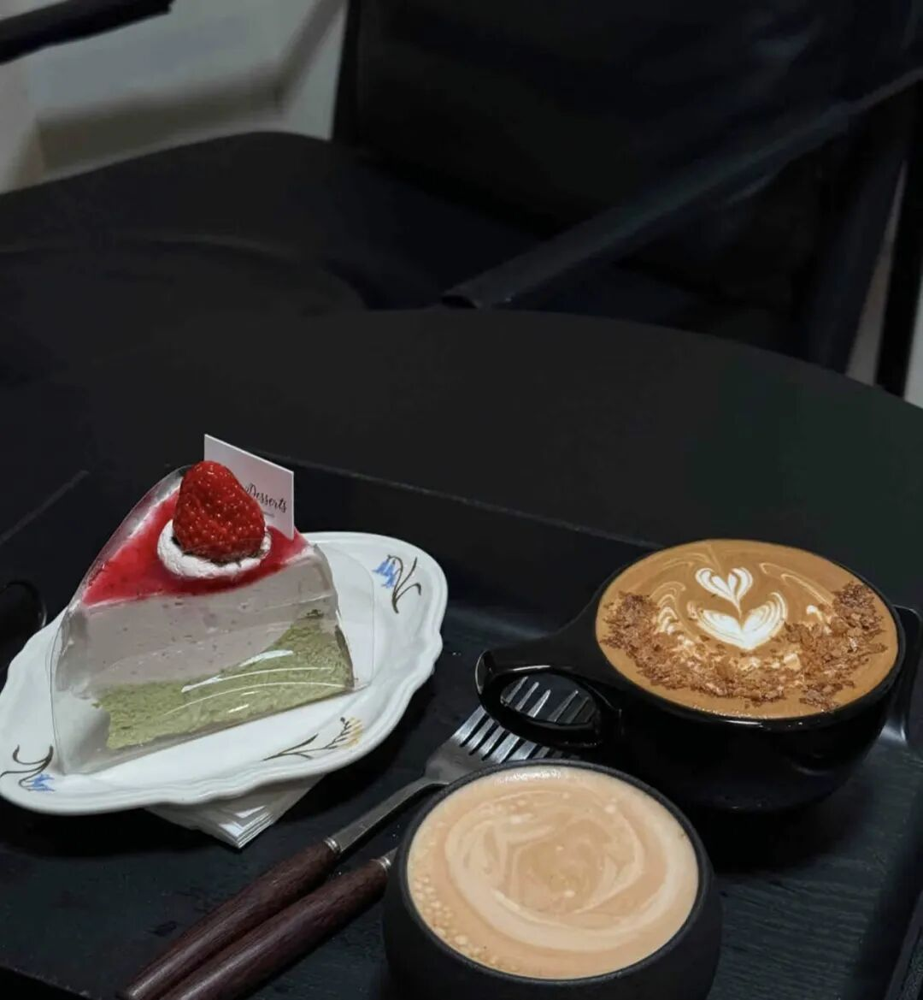

# 睡眼

- 公众号：西多梅
- 发布时间：2025-11-14T09:48:59
- 原文：http://mp.weixin.qq.com/s?__biz=MzYyMTkyNjU1Mg==&mid=2247483699&idx=1&sn=5b159397ec76ed8465f23485a3fe2ae0&chksm=fe9c25be0117cf59274228aa8b15ba49267d481794c934993d317909e135bb4a88ee7d37ca25&scene=126&sessionid=0#rd

> 悲伤和睡意是苦涩温热的良药。

## 正文

我把夕阳形容成将融未融的浓缩咖啡，浮着的是奶黄的澄清的与水无异的滋味，沉下去的搅一搅就成了下雨的浓夜，睡不着。

为什么用咖啡干杯呢？没有酒，没有夜。只有漫长的没有太阳的白天，无限次的清醒，无法拥有醉的资格。

在这里的时间过得极慢，亲爱的。

惟一的快乐好像就是，揉着眼睛看表，发现还有5分钟可睡的瞬间。最近很少写东西，太多的事拼拼凑凑，怀旧、情调、回忆，珍藏，恰好将软肋公之于众目睽睽。墓碑一样沉重地压在心上，太多的苦情电影浸渍了呼吸间的锈迹斑斑，整个人都是北方秋天的阴鸷空气。

气压十分低而浓重，我试图用睡眠来逃避，吞下一团氧气刺痛着鼻咽，用惺忪的眸拘于面前一方，埋进温暖的颗粒绒大衣，偶尔接楼下铁皮罐里冒着热气的水，并同时向往难待的好天气。

天黑得更早了，整个人都是，困倦，模糊，麻痹。有些伤口到了结痂的后期，连血都干涸成萎缩的泥土，捻在手心便散去，远比来时更加包容。你说过你想做阳春三月初的桃花簇簇，世俗地健康地活着，而不是月上柳梢黄昏后的残荷夜雨，死寂到战栗。

究竟如何到了现在的地步，写什么都像没有感情的流水账，但可以光明正大明目张胆地讲，只是单纯悲伤，早已放下。

悲伤和睡意是苦涩温热的良药。

在整个人被揉皱失水的最近，我想说。

