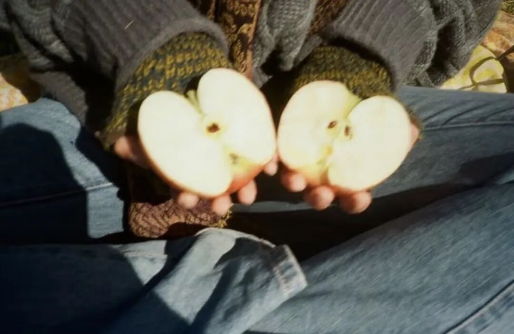

# 何以存在

- 公众号：西多梅
- 发布时间：2026-04-12T17:53:05
- 原文：http://mp.weixin.qq.com/s?__biz=MzYyMTkyNjU1Mg==&mid=2247483741&idx=1&sn=38c6de74c196795c8f57dd04b87100d5&chksm=fec9d84991c185a56f48fd7d9f5081ef513cad173b3064d59748b0acbfa5f16a758ddb8e5292&scene=126&sessionid=0#rd

> “到底放弃自由还是放弃面包”——《孤独面店》

## 正文

烂俗情节里虐天虐地却都能云开月明的故事,读起来或许意义不大。那人的生命岂不是一样,踏在世界的绳索,脚下冰凉虚空,不当心便滑落至尽头处,于是有如履薄冰的一生,鲜血淋漓地延长可行之路,在终点满足地下坠,又有什么分别。

"既然没有意义,干脆就找一风景晴好处停下也尝不可."

做不到的。

万事万物难道不是因欲望而存在吗?渺小如蜉游,也懂趋利避害的保身之法门,人更无法例外。因欲望而生,留下欲望而死亡,行事一定会有自己的考量,喜顺我者,恶逆我者,追求吾爱,远离吾恨,却把自己定位于无欲无求。

到底怎样才会无欲无求。

"梦想,渴望,希冀,愿景,多么美好的词汇,当然与肮脏的欲求不能相提并论。"

我心匪石啊,我无法面对自己身上保有的真实人性,没有办法与自然选择对抗,即使意识到了世间的所谓真善假恶不过是一类杂糅的价值标准,我也不能描绘此外的风物,只缘身在此山中。为了满足自己的欲望而满足他人的欲望,或许是千万年来无法摆脱的宿命。大多数人的生命,出生,成长,死亡,会有同样的生命们加入,一定会的。

所思所念所想或被干扰,打断,裹挟,在夜里反思自己的价值,整理自己的心情,成为第二日的好好小姐或先生,自觉问心无愧得到成长,经历一番寒彻骨我得到了扑鼻梅花香。其实心脏已经痛过,你会永远失去这个夜晚和晕湿的月光。

无法超脱,不如超度已身.看淡一点悲欢,觉得万物无谓.饭疏食饮水,曲肱而枕之,逍遥于山野碧顷流连在烟花雨巷皆无可厚非。时俗固工巧,不愿以心为形役,更不惆怅独悲。既因欲望而发生,既不求意义地活着。无所谓他人评判下的优劣善恶。也本没有界线。

“存在主义即是一种人道主义”
