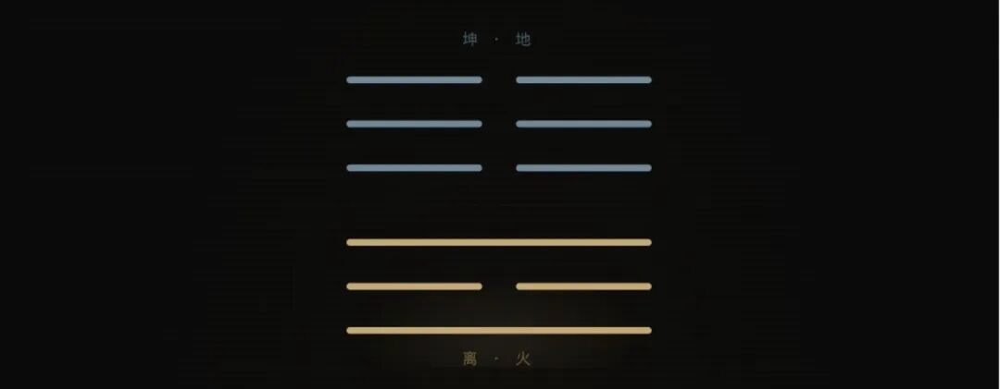

# 冠带。

- 公众号：西多梅
- 发布时间：2026-05-08T23:42:24
- 原文：http://mp.weixin.qq.com/s?__biz=MzYyMTkyNjU1Mg==&mid=2247483753&idx=1&sn=27a9dcb1c02be70a40f70d994ec63402&chksm=fe7e15778864056f7333ecc3843f0ddd0a215ae086cf832da7f95fa7ff8413a2997ebf8b81df&scene=126&sessionid=0#rd

> 二十而受冠，表成人之容，其气尚弱，其技未精，事多不成，屡战屡败，然气幼而位中，技疏而志正，虽事多不成，而屡败屡战。

## 正文

所谓有求而不得。

这要从人为自己开的灯说起。习惯人在室内即要点灯，好像掌握了光的命脉，可是白天已经够亮。

对于痛苦和变格的一种迷恋，所谓暴力美学，常常词不达意将自己和盘托出，窥窃隐匿仅存的热情和感想，佯言自然与松弛的状态，总说着别为我担心。并把这叫做生长在蔓延。

然后创造出一种属于东亚的生活韵脚，醒目、标题、鲜艳、喧嚣。一切积极一切蓬勃一切向上，然后在明确的规则里被告知寻找可打破的缺口，在传统的模式中不断变体，只为了适应朝某方向的进步。有没有可能创新是另一种退后。

每当面谈，都有六个人为此思考和应用着，而且对等的两个总是断线，然后其中一个染上对方的影子，这是一种完全错误的霸凌，人应该在正确的时候做正确的事情而不是超前的事情，求而不得吗人心欲壑吗填不满吗。

其实是一直在溢出，小满不够万全也不够。我必须拔高我的瓶颈，细长易碎也没关系，摇摇欲坠那就把粉饰太平叫做亡羊补牢，嗯。犹未迟也。

某些神话寓言故事讲圣人从头到尾的光辉，然后又编出圣人私心的花边，怎么圣人就不要长成，就一定要让公西华与曾点游刃有余的论道，然后夫子给出得道的点评，很好的语录体诞生了。可是不去做不去接受，谁知道哪条路是正确的。

又突然回到了以心为形役的思考，奚惆怅而独悲啊！你就那么缺五斗米，就那么确定已往不谏吗。就像你有时把心梗确定的认成心动，不也是真挚和错误的。要喘息，要用力，要直起身体，要汪洋恣肆，要等到说不的那天。

地火明夷。
