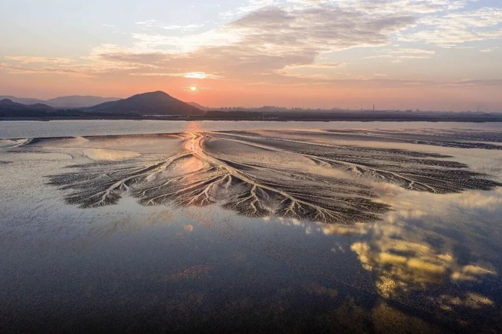

# 重启

- 公众号：西多梅
- 发布时间：2026-05-22T23:14:05
- 原文：http://mp.weixin.qq.com/s?__biz=MzYyMTkyNjU1Mg==&mid=2247483767&idx=1&sn=1f6d5c30c06007061a088fe2d1cbf597&chksm=fecea412b47f56ae92af9b843842c0c2b980d0baa61647284ab3ad74956d71f5d9ab3ab53a44&scene=126&sessionid=0#rd

> 我不能愧对期待与现实 留在犹豫的分叉口。

## 正文

我想我要重新开始了。

闷热腐烂的一日，充斥着人的味道，可能贾宝玉说的半真半假，人是浊水泥，水多则清，反之。那么理所当然的因素是环境，所谓近朱赤则丹，你越靠近什么，越会被什么影响、根植、深种。

人被社会挟裹，社会意识大抵决定于气候吧，冰期文学的峭拔峻冷，暖世文艺的百花齐放，全球气候变暖带来了忧虑和回复的充沛精神。

因何发此言，无乃蒸笼之后一场暴雨夹着雷光，室外是改天换地，屋内是清凉甜香的一周结末。

光是这些吗？当然不够，浅薄的见识到了一些不同：人生选择、当下状态、未来规划。从前总是妄想复制成功，却忽视了本身价值，因此既意识到了，便十分庆幸未晚。

可以说游刃有余地安排了下阶段的自己，无非赶ddl、做汇报、开会、理材料、做数据、写文字。当然会疑惑为何没有感情，其实也一直拖着和朋友的文字约定没有动笔，是因为情感的浓度、关系的亲疏、在意的看法，早已不是我考虑的重心和出发点。可能是人变得市侩汲营了吧，纯粹早已被列进了完成清单，追求不再是所谓的“意识到”，而是“践行”。

践行，哪怕不够圆融不够成熟，总比标榜来的“成熟”“清醒”好上百倍，我常小心眼的揪着过去一些事情放不掉，但何尝不是指引自己离开的动力？背道而驰，的的确确，我痛恨某些时刻懦弱、敏感、扭曲、悲伤、阴暗的自己，但她是我的拼图。能做的是，从此我出发，像水滴像羽管，像潮汐树的前端和末端，狭窄中伸出、拼出千万枝广阔来。

于是泥沙留在河床，留给孕育，我流向海。

又蒸腾向雾，我又重启。

图源新华社
