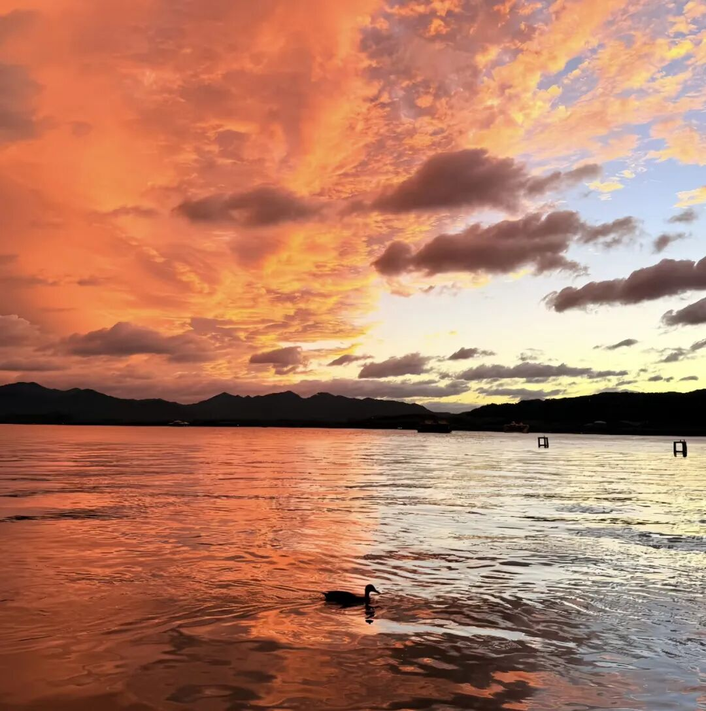

# 轉圜

- 公众号：西多梅
- 发布时间：2026-07-04T23:05:58
- 原文：http://mp.weixin.qq.com/s?__biz=MzYyMTkyNjU1Mg==&mid=2247483771&idx=1&sn=6435d903b3db158ab10b97370d0beb9a&chksm=fe60abd48246d8b52adac8b9b8ba1e77805c481aac514f7c25d74551d965e2fb83b86f0d6fe0&scene=126&sessionid=0#rd

> 还要努力下去！

## 正文

这是某天夜里，阖上眼睛却醒着精神，默念的：

泪水在我的眼里汇满一汪，这绝不会溢出的湖，直到回家那天才会拥有它的潮汐。

正如潮汐周而复始，坚信在这个夏天，前半段人生会有第一个转圜。我看到自己重新将求知欲捡起，重新自言自语，明白不是做错一件事情就彻底穷巷打狗，这种感受说不好，应该是庆幸。

我也庆幸命运总是腾挪出一点日子，让我接受所有全心投入的挫折，比如失败的感情，比如不得不收掉的棱角，以前我总是遇不公愤然起笔，其实磨掉自己的心气后，反而缄口。

在长沙到哈尔滨的飞机上写下这段话，十点半走出综合楼，十二点半站在安检口，关掉了所有的工作消息，然后在逼仄的座位上晕倒一个小时。我惊讶于自己的镇定、变通，仿佛所有以前担心都是痴人说梦杞人忧天，仿佛一百次的失败换来这些，这样也值得。

然后醒来，我看到舷窗外巨大的蘑菇，投下一小块阴影，我在纠结它是乌云还是阴影。豁然开朗，明明白云摆在我眼前。

可能一直都在被教育做人留一线，以至于到了全力的时候退而生却心，过往的宽容和原谅再次证明了懦弱的借口，我才明白人可以选择的，可以渴望世俗意义上盛大的成功的。

当然这并不是真的代表，要钻牛角尖撞南墙，疼了就回去涂药。更多的留一线，是对往事不慕，对将来不闵。接受一切的阴暗与阳光，就像西湖边的世纪晚霞，当时而动。

要拥有在压力集结下能够抽芽的魄力，要敢于在万念俱灰时钻开一粒火星，哪怕三分钟热度，哪怕潮湿的雨熄灭了。

即使不敌你预想万一，也堪堪，是次转机。

屡败屡战。
