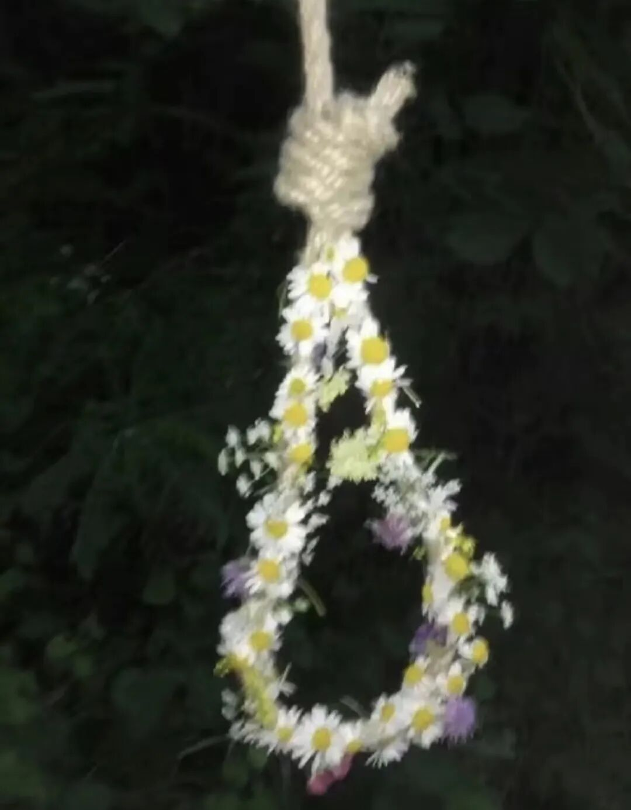

# 乞巧

- 公众号：西多梅
- 发布时间：2026-08-20T01:04:34
- 原文：http://mp.weixin.qq.com/s?__biz=MzYyMTkyNjU1Mg==&mid=2247483783&idx=1&sn=00e6349ce0d457ea25e22c0d6f190f11&chksm=fea04e37bdc2800ed0157034b359fe019329a1a4ef51cfb16303ab2f53d049e069ce76f7ca13&scene=126&sessionid=0#rd

> 此去经年应是良辰好景虚设。

## 正文

此去经年，应是良辰好景虚设——《雨霖铃》

 我其实，也没有非要用文字表达不可的事情了。老师，我幻想过你许诺我的未来，那个我的笔永远在场的未来。

 很久没有挂满面的眼泪在半夜写东西了，上一次还是对无疾而终的难过，现在多了疲惫。 好像以前习惯了用文字讲一切，也含蓄、也坦然，可能生活在变得健康，文字成了健康时不记得吃的保健品，搁置在案前，仅仅是求个心安。

 春花秋月夏蝉冬雪，好景。它在悲伤时表达悲伤，在欣喜时表达欣喜，从前我以为文字是灵性的东西，它流淌的是气息，是原本如此，而至今的文字于我，可能只是谋生、近利。明明知道早晚自己会写下这个意思，在真正写出来前，还是不愿承认。从我堆砌政要、铺陈词藻、挥霍意象时，我的笔就已经绝望。

 “我也要揭发，揭发姹紫嫣红，揭发断壁颓垣！”

 从地基发现三十年文学大厦，蛛丝儿结满雕梁，今年花比去年红的号角吹得响亮，你方唱罢我登场，可知为何至此阴阳？

 空空如也的文章皮囊，披在枯骨身上，于是腐草填了血肉，暮鸦充了喉舌，连楚霸王都会投降，因为这里已经没有人，只有忙着生忙着死的文字投机二道贩。

 便纵有千种风情，更与何人说？

我至今没有找到用再见对抗永别的方法。
