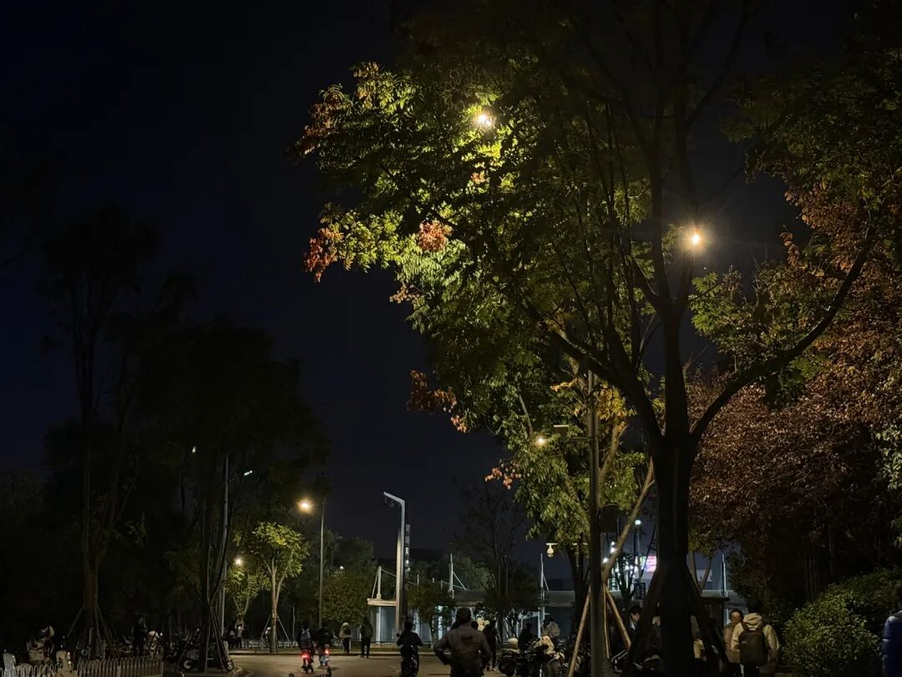

# 要继续.

- 公众号：西多梅
- 发布时间：2026-08-26T22:44:00
- 原文：http://mp.weixin.qq.com/s?__biz=MzYyMTkyNjU1Mg==&mid=2247483800&idx=1&sn=57c8bdc63793998d373ae41d3b7e3f4d&chksm=fe2e04e78a8a675b324581e346cf3d3ae3f757134f894af903d17e0afb91d7968361880b9b17&scene=126&sessionid=0#rd

> 鸡公煲！

## 正文

三月末，结束了一段没有结果的感情，并把焦虑当作日常。平常的和学长请教资料和学习方法，平常的学习部分享会推文，从没想过可以如此顺其自然地联系在一起。

 3月27日到3月30日这三天，是最低谷的日子，权衡、纠缠、求援、奔波，组成了精神生活贫瘠的全部，我不想细细回忆那几天，焦虑到三点，一夜醒醒睡睡，这也是下单手表的原因之一吧。

四月份过得很快，零零碎碎的忙碌和内耗，背古诗获得了很好的思考，偶尔会放纵餐，迷上了王者，月末接到了王多多。

 五一是很好的日子，充实、清闲、自由但孤独，开始抑制不住地想家，想念不那么完美但极具归属感的小城，在脑海翻看往昔所有的一切，并发现环境决定人格的奥妙。

 压力碰撞的夏天，下雨都不会凉爽的夜晚。跑调研补实践请教分析逻辑并深感不足，同时极其愿意和眼界开阔的前辈交流，24小时高强度十多个聊天框，每刻不停的消息。背着琵琶从文院冒雨骑车回天马，在宿舍楼下喝着酒背古诗，在阳台焦虑刷到东北文学然后崩溃淌眼泪，夜里听生命树写文案（我还是没那个胆子把自己的幼稚创作叫做文章）。少食多思，裁剪掉睡眠，对人心对关系对前景对发展的思考是令人痛苦又迷恋的事情。

 我想念那个怯生生但勇敢的孩子，我知道自己性格变化得惊人，棱角收掉外放亲切，但引以为傲的思考逐渐浅薄，沟通也发自内心的营营，但不后悔。因为无法忍受那个被指摘的从初中开始笑起来变得很奇怪的孩子。我原谅她，原谅一切使她变成这样的因素，但也感谢她留住了脆弱和敏感，扛住了加身的期望和心思，是她让我成为了我。

麓南是自由的起点。

 2026.5.17（写于鸡公煲，和ff）

（她说要把第一顿鸡公煲留着跟我吃）
