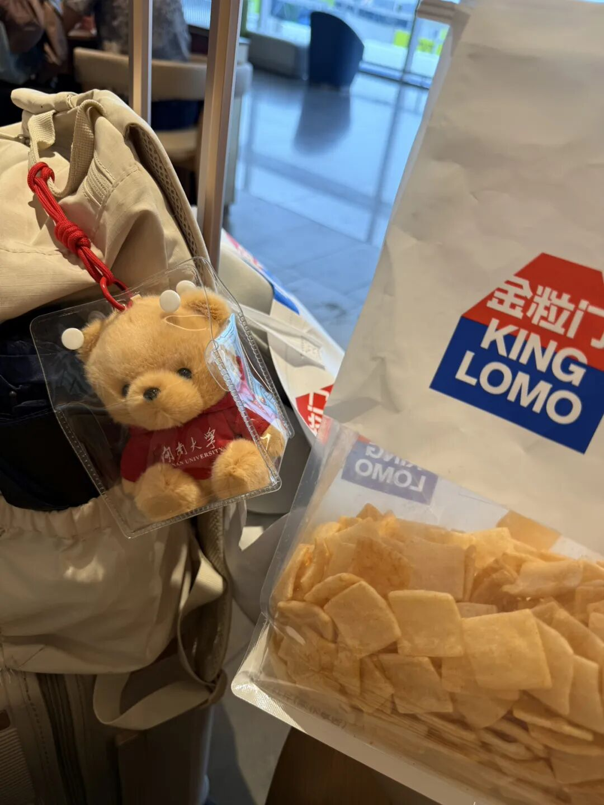

# 在机场和车站滞留那天：

- 公众号：西多梅
- 发布时间：2026-10-02T04:01:14
- 原文：http://mp.weixin.qq.com/s?__biz=MzYyMTkyNjU1Mg==&mid=2247483829&idx=1&sn=c99e09aa557c6b094109e0c14e0df445&chksm=fe3b1ce6e5927ae77f50afbcefdf4f2f2d0ffcb2236639c75a2658d166f7bdce4954971b5873&scene=126&sessionid=0#rd

> 我们在行动中找到安稳的灵魂，在付诸中尝试最初的意义。

## 正文

应该从我讨厌过度思考的头痛说起。

于是毫无意义的早八水课，我没有像往常一样翘掉，而是发呆之余匆匆买下机票，同时大量的眼泪偷偷流到了鼻腔。一直在吸鼻子的一节课。

我不知道这样毫无来由的在高压下的冲动来自哪里，但是事实是，我已经花掉一个月生活费，毫无征兆的回家了。

人竟然能在一天跨越两万五千米，从别人家回到自己家，在言语里轻飘飘的：地铁、飞机、巴士、绿皮、轿车。身类蓬草，兜兜转转却又无所适从。仿佛在回家面前任何颠簸都是值得付诸一炬的成本。我们总是擅长在流离中找到安然的借口，然后试图定下漂泊的目标，叫做故乡。

此心安处是吾乡。

于是飞机晚点，淋过雨提早出门，在机场滞留的三个小时，我成了一杯温暖沙哑的水：喝起来有点腻。我还在思考为什么早上天没有亮自己就出门，中午还能顶着淋湿的头发这样兴致冲冲的拍照。我还在想我是不是真的没有东西可想，焦虑自己没有东西可以焦虑。

然而这并不是我回家的理由。

被调剂的座位、两个冷冽的天气、不友善的邻座、不出所料没赶上的高铁、​卧铺​大哥​此起彼伏​​的​鼾声；

清甜珍惜的小块网纹瓜、霍乱时期的爱情、加了又加辣油的重庆小面、​​十三块钱​两​瓶​的​星巴克、骑着旅行箱在车站胡闹。

你发现了吗，我描写幸福的文字比描写倒霉的，总是多一点。所以又被说服，我们在行动中找到安稳的灵魂，在付诸中尝试最初的意义。

这就是我回家和心安理得在火车厢的接口写下这些的原因。即使在卧铺被气味和声音打扰得无可奈何，可是一个半小时之后，我就​到家了呀。

图​源​我自己 ​不删

2026​年10​月2​日 ​北京时间3:58​在​车厢​接口​吹风
